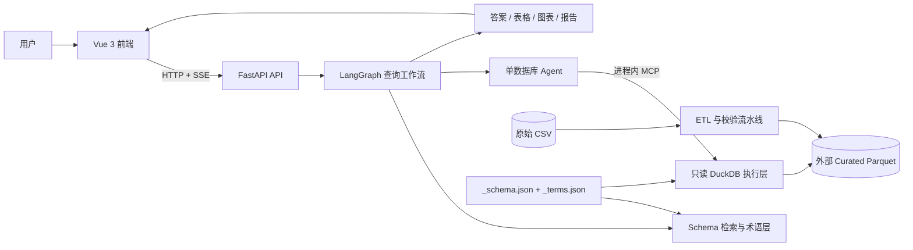
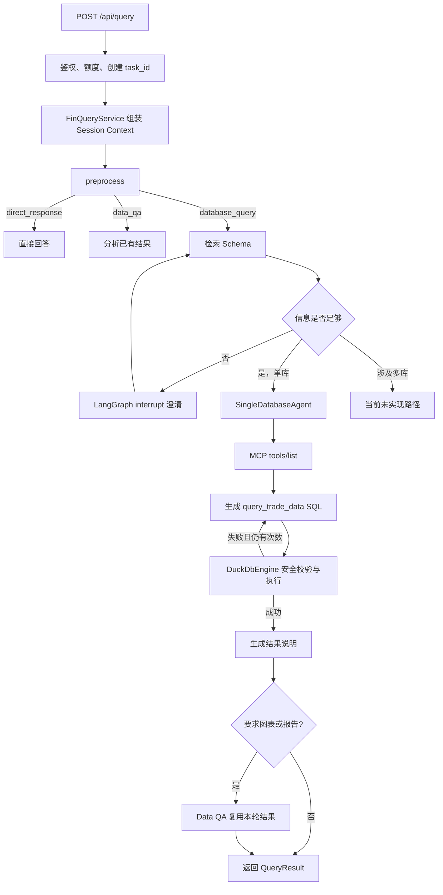
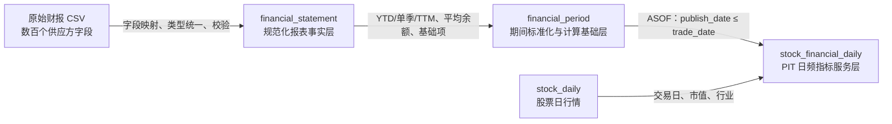
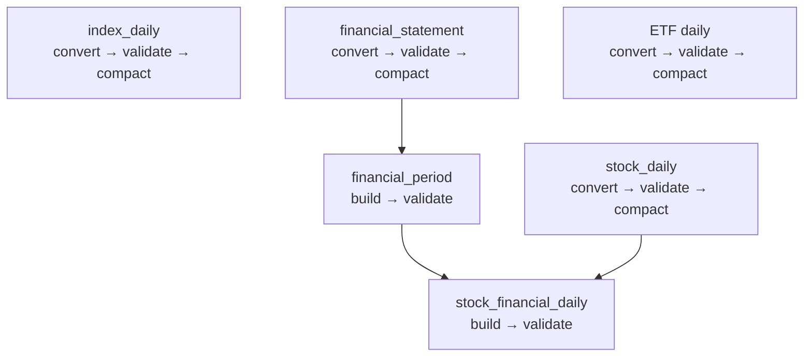

# FinQuery 当前架构说明

> 文档快照：2026-10-16  
> 适用代码库：`D:\FinQuery`  
> 目的：从系统、查询、数据和扩展四个角度解释加入财务明细表、财务期间表和日频财务指标表后的真实架构。

## 1. 先建立整体认识

FinQuery 是一个中文自然语言金融查询应用。用户不直接编写 SQL，而是在 Vue 前端提出问题；FastAPI 后端使用模型理解意图，通过字段级 Schema 检索缩小上下文，再由单库查询 Agent 生成只读 DuckDB SQL，最终把本地 Parquet 中的数据整理为表格、文字分析或图表。

当前系统可以概括成五层：



这五层分别解决不同问题：

| 层次 | 主要职责 | 不应承担的职责 |
| --- | --- | --- |
| 前端 | 登录、会话、工作区、SSE 进度、结果展示 | 不决定指标公式，不直接访问数据文件 |
| API/服务 | 鉴权、任务和会话管理、调用工作流 | 不直接拼接模型 SQL |
| 工作流/Agent | 路由、检索、澄清、生成并修正 SQL、组织回答 | 不绕过 SQL 安全层读文件 |
| 元数据 | 描述表、字段、术语、指标口径和权限 | 不保存大规模事实数据 |
| 数据/ETL | 把原始 CSV 转成稳定、可验证、可查询的 Parquet | 不处理自然语言理解 |

## 2. 仓库与外部数据的边界

项目代码和大体量业务数据是刻意分离的。

```text
D:\FinQuery\
├─ frontend/                         Vue 3 + TypeScript 用户界面
├─ backend/
│  ├─ app/                           FastAPI、工作流、检索、查询、安全
│  ├─ data/databases/trade_data/     Schema 与统一术语表
│  ├─ scripts/                       ETL、构建和数据校验
│  └─ tests/                         后端单元与集成测试
├─ docs/                             设计、公式、验证和学习文档
├─ compose.yaml                      本地、数据工具、公开预览服务
└─ README.md                         安装和数据库注册入口

D:\trade_data\                      原始数据根目录
└─ trade_data/ 或各 source_subdir/   供应方 CSV

D:\trade_data_curated\
└─ trade_data/                       查询所用 Parquet 与流水线清单
```

仓库中的 [`_schema.json`](../backend/data/databases/trade_data/_schema.json) 和 [`_terms.json`](../backend/data/databases/trade_data/_terms.json) 可以进入 Git；数百 MB 到数 GB 的 Parquet 不进入 Git。运行时由 `CURATED_DATA_ROOT` 指向外部整理目录，[`database_sources/__init__.py`](../backend/app/database_sources/__init__.py) 再把逻辑数据库 `trade_data` 映射到 `D:\trade_data_curated\trade_data`。

这意味着：

- **代码决定怎么构建和查询数据**；
- **Schema 决定系统允许模型看到和引用什么**；
- **术语表决定业务语言怎样映射到表、字段和指标**；
- **外部 Parquet 才保存真正的大规模查询数据**。

## 3. 当前代码目录的职责

### 3.1 前端

| 路径 | 职责 |
| --- | --- |
| [`frontend/src/App.vue`](../frontend/src/App.vue) | 登录、会话、工作区、提问、澄清、历史结果和字段库的主界面 |
| [`frontend/src/api.ts`](../frontend/src/api.ts) | API 客户端、Bearer Token、SSE 查询流、超时和错误处理 |
| [`frontend/src/types.ts`](../frontend/src/types.ts) | 与后端 Pydantic 模型对应的 TypeScript 类型 |
| `frontend/src/components/` | Markdown、结果表、报告卡片和图表组件 |
| `frontend/src/charts/` | ECharts 主题和配置转换 |

浏览器把 Token 放在 `sessionStorage`，会话和工作区交互状态主要留在前端。查询接口不是一次性 JSON 响应，而是接收 SSE：过程中产生 `progress` 事件，最后产生一个完整的 `result` 事件。

### 3.2 后端入口与服务

| 路径 | 职责 |
| --- | --- |
| [`backend/app/main.py`](../backend/app/main.py) | 创建 FastAPI 应用、配置 CORS、挂载路由 |
| [`backend/app/api/routes.py`](../backend/app/api/routes.py) | 登录、Schema、查询、澄清、记忆等 HTTP 接口 |
| [`backend/app/services/finquery_service.py`](../backend/app/services/finquery_service.py) | 查询服务门面；连接用户、Session、Task 与工作流 |
| [`backend/app/services/session_context.py`](../backend/app/services/session_context.py) | 组装短期上下文、最近结果和待澄清任务 |
| [`backend/app/services/memory_store.py`](../backend/app/services/memory_store.py) | 保存用户主动收藏的结果和字段 |
| [`backend/app/models.py`](../backend/app/models.py) | 请求、响应、澄清和图表等 Pydantic 契约 |

`POST /api/query` 会先消费游客额度，然后启动一个后台线程执行查询；主请求线程持续从进度队列取事件并通过 SSE 返回。每 25 秒发送一次 ping，避免长查询期间连接被中间代理关闭。

### 3.3 查询工作流

| 路径 | 职责 |
| --- | --- |
| [`backend/app/preprocessing.py`](../backend/app/preprocessing.py) | 一次模型调用完成意图路由、问题改写和检索词提取 |
| [`backend/app/workflows/query_graph.py`](../backend/app/workflows/query_graph.py) | LangGraph 节点、分支、澄清中断和结果串联 |
| [`backend/app/querying/single_database_agent.py`](../backend/app/querying/single_database_agent.py) | 发现 MCP 工具、让模型生成 SQL、失败后有限重试 |
| [`backend/app/querying/duckdb_engine.py`](../backend/app/querying/duckdb_engine.py) | SQL AST 校验、权限校验、注册 Parquet/CSV 只读视图并执行 |
| [`backend/app/querying/response_generator.py`](../backend/app/querying/response_generator.py) | 根据真实查询结果生成标题和解释 |
| [`backend/app/querying/data_qa_agent.py`](../backend/app/querying/data_qa_agent.py) | 对已有结果继续分析，或生成图表/报告 |

### 3.4 Schema、术语与检索

| 路径 | 职责 |
| --- | --- |
| [`backend/app/database.py`](../backend/app/database.py) | 加载启用数据库，校验 Schema/术语，给字段注入别名和指标元数据 |
| [`backend/app/retrieval/service.py`](../backend/app/retrieval/service.py) | BM25、向量召回、RRF 融合、Rerank 和工作区字段注入 |
| [`backend/app/retrieval/store.py`](../backend/app/retrieval/store.py) | 字段文档和向量缓存 |
| [`backend/app/retrieval/graph.py`](../backend/app/retrieval/graph.py) | 把召回字段整理成最小 Schema 图和模型上下文 |
| [`backend/app/capabilities.py`](../backend/app/capabilities.py) | 向预处理模型说明系统能查询什么 |

### 3.5 MCP 与安全

| 路径 | 职责 |
| --- | --- |
| [`backend/app/mcp_runtime/server.py`](../backend/app/mcp_runtime/server.py) | 动态注册时间、图表和 `query_<database>` 工具 |
| [`backend/app/mcp_runtime/client.py`](../backend/app/mcp_runtime/client.py) | 进程内工具发现和调用 |
| [`backend/app/skills/database_query/SKILL.md`](../backend/app/skills/database_query/SKILL.md) | 单库 Agent 的运行时查询规则和财务查询口径 |
| [`backend/app/security/access_control.py`](../backend/app/security/access_control.py) | 数据库、表和用户作用域过滤 |
| [`backend/app/security/auth.py`](../backend/app/security/auth.py) | 当前的登录、Token 和角色实现 |

这里的 MCP 是**同一 Python 进程内的工具边界**，不是一个独立远程服务。它的价值是让 Agent 只能从公开的工具清单中选择动作，并统一工具输入输出契约。普通数据库不需要手写新工具；系统按已启用 Schema 自动生成 `query_trade_data` 之类的只读工具。

## 4. 一次查询怎样穿过系统

### 4.1 主流程



预处理只把请求分成三种意图：

- `direct_response`：不需要查库的普通问答；
- `data_qa`：分析已有结果表；
- `database_query`：检索 Schema 后生成 SQL 查询本地数据库。

当用户说“画图”或“生成报告”时，并不会凭空生成数据。系统先完成数据库查询，再把本轮真实结果交给 `data_qa` 节点生成图表规格或 Markdown 报告。

### 4.2 为什么先检索 Schema

当前 `trade_data` 已有数百个字段。把完整 Schema 每次都交给模型，既浪费上下文，也更容易让模型选错表或字段。系统因此把一个问题变成检索词，再依次执行：

```text
问题与 retrieval_terms
        │
        ├─ BM25 关键词召回
        └─ Embedding 向量召回
                  │
               RRF 融合
                  │
                Rerank
                  │
       命中字段 + 用户已确认字段
                  │
             最小 Schema 图
```

`_terms.json` 中的字段别名、业务概念、指标定义、公式、失效条件、单位和周期口径，都会进入字段检索文档。因此“企业倍数”“EV/EBITDA”“息税折旧摊销前利润倍数”等不同说法可以指向同一个物理字段。

### 4.3 SQL 的安全边界

所有模型生成 SQL 必须经过 [`DuckDbEngine._validate_sql`](../backend/app/querying/duckdb_engine.py)：

1. 一次只能有一条语句；
2. 只允许 `SELECT` 或 `WITH` 查询；
3. 禁止写入、DDL、`COPY`、`ATTACH` 和事务等操作；
4. 禁止 `SELECT *`，必须显式列出字段；
5. 只能引用当前数据库 Schema 中存在的表；
6. 单表查询还会检查字段是否真实存在；
7. 数据库和表必须在当前用户权限范围内；
8. 最多向上层返回 200 行。

Agent 最多调用 3 次工具。SQL 失败后会用数据库错误和精简上下文修正，但禁止原样重试同一条失败 SQL，也不能猜测 Schema 外字段。

## 5. 新的财务数据架构

加入财务表以后，财务数据不再是“在行情表里附带几个快照字段”，而是形成了三层明确的数据产品：



### 5.1 三张表的定位

| 表 | 粒度与主键语义 | 当前字段数 | 主要用途 |
| --- | --- | ---: | --- |
| `financial_statement` | 股票 × 报表类型 × 报告期 × 披露版本 | 74 | 查原始财报明细、追溯具体披露版本 |
| `financial_period` | 同上，但增加标准化期间值与计算基础 | 126 | 审核 YTD/单季/TTM、平均余额和公式组成项 |
| `stock_financial_daily` | 股票 × 交易日 | 99 | 历史选股、横截面比较、估值和财务指标查询 |

截至本快照，外部 Curated 数据的实测状态是：

| 表 | 行数 | 股票数 | 日期范围 |
| --- | ---: | ---: | --- |
| `financial_statement` | 592,043 | 5,921 | 报告期 2007-03-31 至 2026-09-30；最新披露日 2026-10-16 |
| `financial_period` | 592,043 | 5,921 | 报告期 2007-03-31 至 2026-09-30；最新披露日 2026-10-16 |
| `stock_financial_daily` | 18,237,130 | 5,916 | 交易日 1990-12-19 至 2026-10-15 |

行数和日期是当前本地文件的快照，不是代码中的固定常量；每次更新后应以 Parquet 和 manifest 为准。

### 5.2 第一层：`financial_statement`

[`financial_statement_pipeline.py`](../backend/scripts/financial_statement_pipeline.py) 从 `stock-fin-data-xbx` 原始 CSV 中抽取并统一字段。它保留的是**披露事实**，同一报告期可以因不同 `publish_date` 存在多个版本。

字段主要分为：

- 身份与时间：`symbol`、`statement_format`、`report_date`、`publish_date`；
- 资产负债：货币资金、应收、存货、流动资产、固定资产、借款、应付、流动负债、长期负债、权益等；
- 利润：收入、成本、税费、研发、财务费用、利息、利润、所得税、归母净利润等；
- 现金流：经营/投资/筹资现金流、期末现金、借款、还债、分红利息、资本开支等；
- 非现金项目：固定资产折旧、无形资产摊销、长期待摊费用摊销等。

这层不应该被误解为“单季度表”。供应方的利润表和现金流量表字段通常采用年初至报告期末的累计口径，所以还需要下一层进行期间标准化。

### 5.3 第二层：`financial_period`

[`financial_period_pipeline.py`](../backend/scripts/financial_period_pipeline.py) 不再读取原始 CSV，而是从 `financial_statement` 构建标准化财务期间表。它解决四类问题：

1. 标注财年、季度和期间类型：`Q1`、`H1`、`Q3`、`FY`；
2. 把累计值还原为单季度值；
3. 组合当前期、上年年报和上年同期，计算 TTM；
4. 准备估值和经营效率指标所需的中间基础项。

典型基础项包括：

- `cash_and_equivalents`：现金及等价物，并记录采用哪个来源字段；
- `receivables_for_turnover`、`payables_for_turnover`：周转率代理口径；
- `interest_bearing_debt`：有息债务；
- `operating_working_capital`：经营营运资本；
- `invested_capital`：投入资本；
- `depreciation_and_amortization_ttm`：折旧摊销 TTM；
- `net_debt_issuance_ttm`：净债务融资 TTM；
- 各类本期/上年同期简单平均余额。

这层的关键约束是：用于构造当前记录的历史组成项，其披露日不能晚于当前记录的 `publish_date`。例如，在构造某次三季报版本的 TTM 时，系统只能使用当时已经披露的年报和上年同期数据。

### 5.4 第三层：`stock_financial_daily`

[`stock_financial_daily_pipeline.py`](../backend/scripts/stock_financial_daily_pipeline.py) 把 `stock_daily` 的每个股票交易日，与当日已经可见的最新 `financial_period` 快照连接起来。

核心条件是：

```text
financial_publish_date <= trade_date
```

代码使用 DuckDB `ASOF LEFT JOIN` 找到每个交易日当时已经披露的最新版本，并额外检查报告期不能随交易日倒退。这张表把高成本、容易出错的历史时点关联提前物化，因此是自然语言指标查询的首选表。

它包含三类字段：

- 交易日上下文：股票、交易日、名称、行业、总市值；
- 审计基础：采用的财报报告期、披露日、报表类型、TTM/YTD/单季值、比较基期；
- 最终指标：估值、盈利、增长、杠杆、偿债、周转、现金周期、自由现金流和 ROIC。

## 6. 三种日期必须分清

财务查询中最容易出现的错误，不是公式写错，而是时间含义混淆。

| 日期 | 含义 | 例子 |
| --- | --- | --- |
| `report_date` | 财务数据描述的经济期间结束日 | 2026-09-30 三季报报告期 |
| `publish_date` | 市场能够获知该财报版本的日期 | 2026-10-16 披露 |
| `trade_date` | 股票价格和市值所对应的交易日 | 2026-10-15 收盘 |

历史回测或“某天当时的 PE”必须用 `publish_date <= trade_date`。如果直接把 9 月 30 日报告期数据连接到 9 月 30 日行情，就会让市场提前知道 10 月才披露的信息，产生前视偏差。

因此不同问题应选择不同表：

| 问题 | 首选表 |
| --- | --- |
| 某公司某期原始货币资金、存货、借款是多少 | `financial_statement` |
| 某次披露对应的单季收入、TTM EBITDA 基础是什么 | `financial_period` |
| 2025-06-30 当时全市场 PE、ROIC、现金周期排名 | `stock_financial_daily` |
| 纯价格、成交、资金流或指数成分查询 | `stock_daily` |

## 7. 财务指标是怎样进入系统的

### 7.1 指标定义的唯一入口

统一术语文件 [`backend/data/databases/trade_data/_terms.json`](../backend/data/databases/trade_data/_terms.json) 包含四组内容：

| 区域 | 用途 |
| --- | --- |
| `table_terms` | 表的业务叫法 |
| `field_terms` | 物理字段别名 |
| `concept_terms` | 财务概念、定义和关联词 |
| `derived_metric_terms` | 派生指标名称、别名、公式、失效条件和物理落点 |

当前登记 75 个派生指标，其中 38 个为 `active`、37 个为 `planned`。`active` 指标必须通过 `field_id` 指向 Schema 中真实存在的物理字段；加载时 [`database.py`](../backend/app/database.py) 会验证这个引用，并把指标元数据注入对应字段。

这条规则很重要：**术语表可以描述规划中的指标，但只有落到真实 Schema 字段并标记为 active，Agent 才应把它当成可直接查询的指标。**

### 7.2 当前已物化指标

现有 38 个 active 指标中，有 6 个来自原 `stock_daily` 快照：

- `pe_ttm`、`pb`、`pcf_ttm`、`earnings_yield_ttm`；
- `liabilities_to_assets`、`liabilities_to_equity`。

另有 32 个位于 `stock_financial_daily`，覆盖：

- 估值：归母 PE、归母 PB、PS、EV/Sales、EV/EBIT、EV/EBITDA；
- 盈利与效率：毛利率、EBITDA 利润率、净利率、ROE、ROA、ROIC、资产周转率；
- 偿债与杠杆：流动比率、速动比率、有息债务权益比、净债务/EBITDA、利息保障倍数；
- 营运效率：DSO、DIO、DPO、现金转换周期；
- 现金流：经营现金含量、经营现金流率、FCFF、FCFE；
- 增长：营收/利润同比、环比和三年 CAGR。

完整公式、分母约束和口径说明见 [`financial-metrics-formulas.md`](financial-metrics-formulas.md)，实施与数据质量验证见 [`financial-metrics-validation.md`](financial-metrics-validation.md)。

### 7.3 为什么结果可能是 NULL

NULL 在财务指标系统中通常是口径保护，不等于程序故障。常见原因包括：

- 分母为 0 或没有意义；
- TTM 或比较基期组成项不完整；
- 交易日之前尚未披露财报；
- 增长率基期不为正；
- 指标不适用于当前报表类型；
- 极端或非有限计算结果被拦截。

当前通用 P2 指标只对 `一般企业` 计算。银行、证券、保险等金融企业的资产负债结构和营业成本口径不同，如果强行套用一般企业的流动比率、现金周期、EV/EBITDA 或 ROIC，数值虽然可能算得出来，却不具有一致的经济含义，所以系统返回 NULL。

## 8. 数据更新架构

统一入口是 [`backend/scripts/update_curated_data.py`](../backend/scripts/update_curated_data.py)，任务定义位于 [`backend/scripts/data_update_jobs.json`](../backend/scripts/data_update_jobs.json)。任务按配置顺序运行，并检查依赖是否已经成功。



这里区分两类流水线：

- **源数据流水线**使用 `convert / validate / compact`，把目录中的 CSV 增量转换为分片 Parquet，再压实为单个查询文件；
- **派生数据流水线**使用 `build / validate`，从已有 Curated Parquet 重建期间表或日频指标表。

财务链路的顺序不可交换：先更新财报事实层，再构建期间层；只有行情表和期间层都成功，才能构建日频财务指标层。

每张派生表都生成 manifest，记录 pipeline 版本、行数、文件名和字节数。验证器重点检查：

- 主键重复；
- 必要字段、日期和行数；
- 未来披露引用；
- 报告期倒退；
- 非有限指标；
- 指标公式与物化结果不一致；
- 非一般企业不应出现的通用 P2 值。

## 9. 部署形态

[`compose.yaml`](../compose.yaml) 同时定义三类服务：

1. 常规开发：`backend` 和 `frontend`；
2. 数据准备：股票、指数、财报和 ETF 的一次性工具容器；
3. 公开预览：`backend-public`、网关和 Cloudflare Tunnel。

原始目录和 Curated 目录以只读卷挂载到查询后端。ETL 工具容器才获得写 Curated 目录的职责。这样可以降低模型查询路径意外修改数据的风险。

公开预览还包含游客额度持久卷；但当前认证、Bearer Token、活动任务和 LangGraph 检查点主要是内存状态，并不是生产级分布式会话系统。

## 10. 状态、记忆与持久化边界

项目里有几种容易混淆的“记忆”：

| 名称 | 内容 | 生命周期 |
| --- | --- | --- |
| 前端会话状态 | 对话列表、工作区选择、当前结果 | 浏览器页面/本地状态 |
| LangGraph Checkpoint | 正在执行或等待澄清的 Graph State | 当前后端进程内存 |
| Session Context | 最近轮次、最近结果、路由上下文 | 当前服务实例 |
| Saved Memory | 用户主动保存的结果表或字段 | JSON 文件，可跨请求 |
| Session Archive | 可选的已完成消息和摘要 | SQLite；不能恢复中断中的 Graph |
| Schema Store | 字段文档和向量 | 可重建缓存，不是业务数据 |

因此重启服务以后，已保存结果可能仍在，但正在等待澄清的 LangGraph 任务不会自动恢复。若未来做多实例部署，需要把任务、Checkpoint、Token 和进度事件迁移到共享持久化基础设施。

## 11. 权限如何贯穿查询链路

权限不是只在 HTTP 入口检查一次，而是逐层收缩：

```text
登录用户与角色
  → /api/schema 只返回可见表
  → Schema 检索只召回可见字段
  → MCP 只注册可见数据库工具和表
  → DuckDB 再校验数据库与实际引用表
  → Task、Memory 按 user_id 隔离
```

当前认证实现适合本地和演示环境，不应直接视为生产安全方案。真正上线还需要外部身份系统、持久 Token、密钥管理、审计日志和多实例一致性。

## 12. 当前设计中几个重要取舍

### 12.1 为什么物化日频指标，而不在每次查询时现场计算

日频财务指标表占用更多磁盘，但换来四个好处：

- PIT 关联规则只实现和验证一次；
- 自然语言生成的 SQL 更短、更稳定；
- 横截面筛选不需要每次扫描并组合全部披露版本；
- 查询结果可以保留公式基础字段，便于审计。

### 12.2 为什么保留三层，而不是只留最终指标表

最终指标表适合“用”，但不够适合“查错”。原始事实层可以回答供应方原值是什么，期间层可以回答单季/TTM 怎样拼出，日频层可以回答某交易日市场当时看到了什么。三层分别提供来源审计、口径审计和时点审计。

### 12.3 为什么 Schema 里暂时没有表间 relations

当前 `_schema.json` 没有声明跨表关系边。主要查询场景通过 `stock_financial_daily` 预先物化了行情和财务关联，所以单表就能完成大多数历史选股。代价是：如果问题确实要求同时查询两张原始表，Schema Graph 不会自动补出一条显式关系路径，Agent 需要更明确的上下文，或未来补充受验证的关系定义。

### 12.4 已知边界

- 多个数据库可以注册和启用，但跨数据库单次查询路径仍未实现；
- 查询最多返回 200 行，适合分析展示，不是批量导出服务；
- Schema 语义检索依赖 Embedding 和 Rerank 服务，失败时会明确报出阶段错误；
- 财务 P2 公式目前主要面向一般企业，金融行业需要独立口径；
- `stock_financial_daily` 是重建型大表，更新成本高于普通增量行情表；
- 前端尚无浏览器自动化测试，主要依赖 TypeScript 构建和人工验证。

## 13. 以后怎样安全扩展

### 13.1 增加一个原始财报字段

推荐顺序：

1. 确认供应方字段含义、单位、报表类型和历史覆盖；
2. 在 `financial_statement_pipeline.py` 增加规范化映射；
3. 在 `_schema.json` 的 `financial_statement` 增加物理字段；
4. 在 `_terms.json` 的 `field_terms` 增加中文术语和同义词；
5. 若它是期间流量项，在 `financial_period_pipeline.py` 增加 YTD/单季/TTM；
6. 若日频指标需要它，再传递到 `stock_financial_daily`；
7. 更新校验和测试，按依赖顺序重建三层数据。

### 13.2 增加一个派生指标

推荐顺序：

1. 先在术语和公式文档中写清定义、单位、期间口径、适用行业、NULL 条件；
2. 确认所有基础字段已经进入事实层和期间层；
3. 在 `_terms.json/derived_metric_terms` 登记指标，实施前保持 `planned`；
4. 在 `stock_financial_daily_pipeline.py` 的指标清单和 SQL 表达式中实现；
5. 在 `_schema.json` 增加最终物理字段；
6. 将术语状态改为 `active`，并用 `field_id` 绑定该字段；
7. 增加逐公式一致性、空值率、非有限值、行业适用性和 PIT 校验；
8. 重建数据，再执行后端测试和前端构建。

不要只在 Prompt 中教模型现场计算复杂指标。公式如果对产品口径重要，应在 ETL 中可重复实现、在术语中可检索、在验证器中可核对。

### 13.3 增加一个数据库

新增数据库需要：

- 新建 `backend/data/databases/<database>/_schema.json` 和 `_terms.json`；
- 在 `backend/app/database_sources/` 注册数据源；
- 配置 `DATABASE_SWITCHES` 和查询目录；
- 为角色配置可见表；
- 增加完整性、权限和查询注册测试。

MCP 数据库工具会由 Schema 自动生成，不需要为普通数据库手写一个工具。更完整的清单见仓库根目录 [`README.md`](../README.md) 和 [`AGENTS.md`](../AGENTS.md)。

## 14. 验证与测试入口

后端测试使用 `unittest`，主要覆盖路由、权限、数据库开关、检索、Skill、MCP、查询重试、数据流水线、公开预览和短期记忆。前端目前以生产构建作为最低类型检查。

常用命令：

```powershell
# 后端测试
Set-Location D:\FinQuery\backend
.venv\Scripts\python.exe -m unittest discover -s tests -p "test_*.py"

# 财务三层校验
.venv\Scripts\python.exe scripts\financial_statement_pipeline.py validate
.venv\Scripts\python.exe scripts\financial_period_pipeline.py validate
.venv\Scripts\python.exe scripts\stock_financial_daily_pipeline.py validate

# 前端类型检查与生产构建
Set-Location D:\FinQuery\frontend
npm run build
```

数据校验与代码测试解决的问题不同：测试证明程序分支符合预期；数据校验证明当前这一批 Parquet 没有重复键、未来引用、公式错配等问题。两者都需要运行。

## 15. 推荐的源码阅读顺序

如果目标是快速理解整个系统，建议按下面顺序阅读：

1. 本文：先建立模块边界和数据分层；
2. [`frontend/src/api.ts`](../frontend/src/api.ts)：理解浏览器如何发请求和接收 SSE；
3. [`backend/app/api/routes.py`](../backend/app/api/routes.py)：理解 HTTP 入口；
4. [`backend/app/services/finquery_service.py`](../backend/app/services/finquery_service.py)：理解 Session、Task 和工作流的连接；
5. [`backend/app/workflows/query_graph.py`](../backend/app/workflows/query_graph.py)：理解完整查询状态机；
6. [`backend/app/retrieval/service.py`](../backend/app/retrieval/service.py)：理解为什么模型只看到少量相关字段；
7. [`backend/app/querying/single_database_agent.py`](../backend/app/querying/single_database_agent.py) 和 [`duckdb_engine.py`](../backend/app/querying/duckdb_engine.py)：理解 SQL 如何生成、重试和受控执行；
8. [`backend/data/databases/trade_data/_schema.json`](../backend/data/databases/trade_data/_schema.json) 和 [`_terms.json`](../backend/data/databases/trade_data/_terms.json)：理解元数据契约；
9. 三个财务流水线脚本：沿 `financial_statement → financial_period → stock_financial_daily` 阅读；
10. [`financial-metrics-formulas.md`](financial-metrics-formulas.md)：理解具体公式和口径。

已有的 [`finquery-architecture-learning-notes.md`](finquery-architecture-learning-notes.md) 更深入解释 BM25、RRF、MCP、LangGraph 和上下文概念，可以作为本文的原理补充；本文则以当前代码和新增财务数据链路为准，侧重模块边界和实际落点。

## 16. 一句话总结

FinQuery 当前的核心不是“让模型自由查询 CSV”，而是：**先用可版本化的 ETL 把原始行情和财报变成经过 PIT 校验的分析数据产品，再用统一 Schema、术语、权限、Skill、MCP 和只读 SQL 验证层，把模型的自由度限制在可解释、可审计的查询边界内。**
